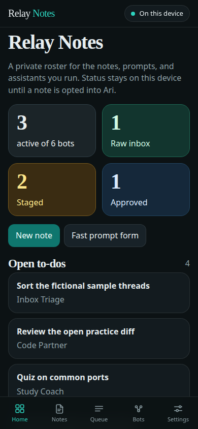
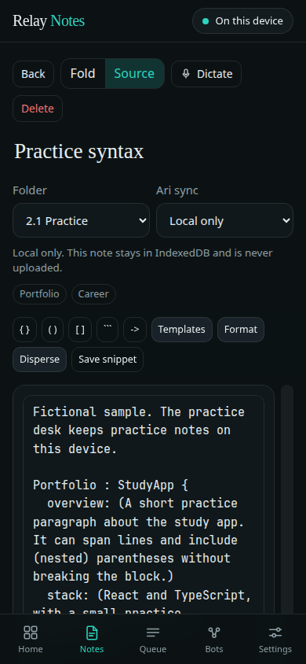
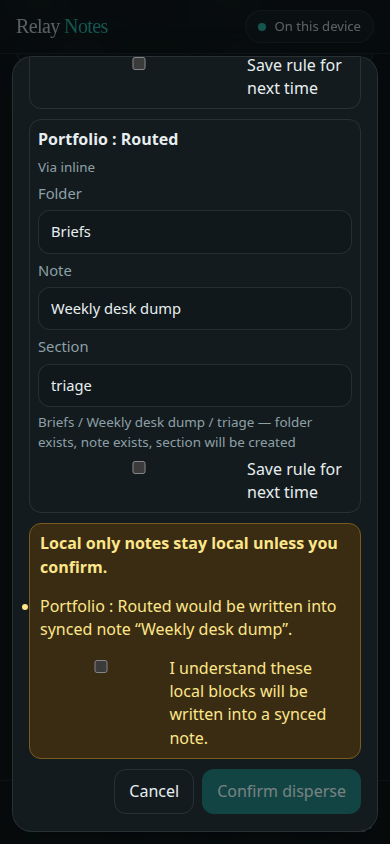
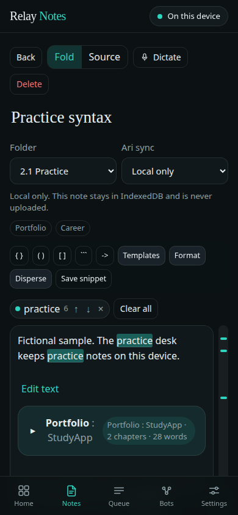
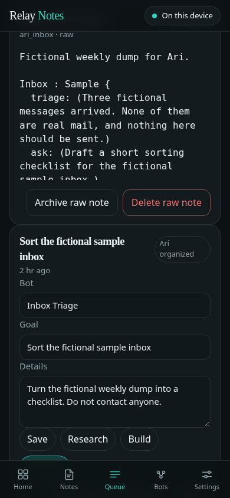
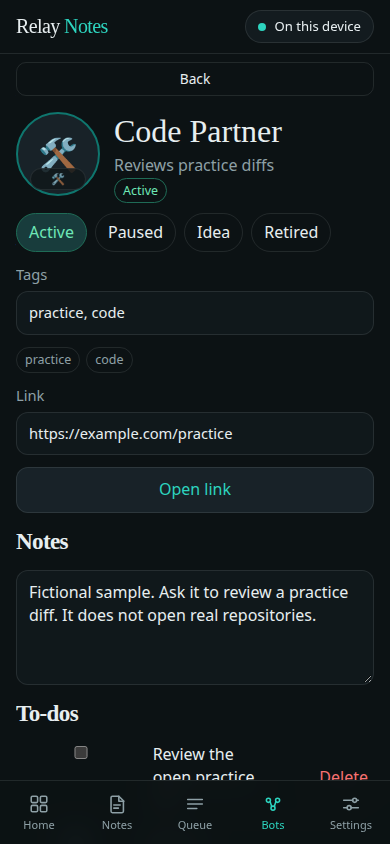
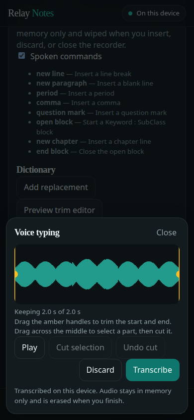
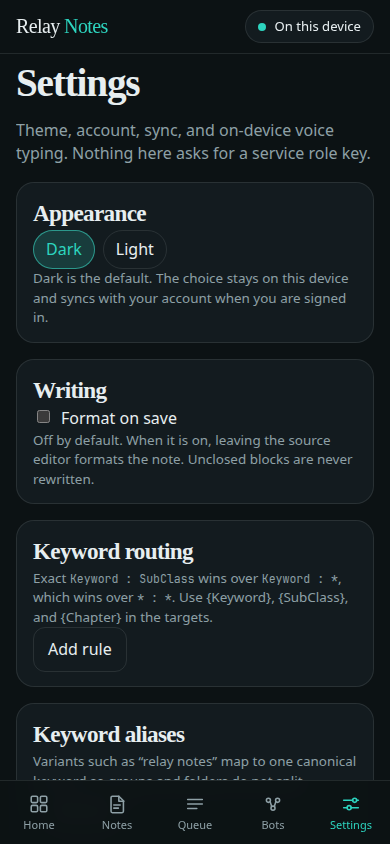

# Relay Notes

Relay Notes is a mobile-first, offline-first command center for structured notes, bot cards, and a two-way review queue. It installs as a PWA, keeps the workspace in IndexedDB, and syncs with Supabase only after you sign in. Notes marked **Local only** never leave the device.

Dark is the default. The shell follows the same slate canvas, tinted summary tiles, serif headings, and teal accent as a small fleet roster: bottom navigation on a phone, a left rail on a wide screen.



## What you can do

**Home** summarizes active bots, the raw Ari inbox, staged items, and approved prompts, and keeps new notes and the fast prompt one tap away.

**Notes** are MCI-style folders plus a forgiving block syntax:

```text
Portfolio : StudyApp {
  overview: (A paragraph can span lines
and include (nested) parentheses.)
  stack: (React and TypeScript)
}
```

Fold a keyword or a chapter without rewriting the source. Search by section, note, or folder. Long-press a word (or Alt-click) to mark every occurrence, then use the chips or the color ticks on the overview ruler to jump between them.

The editor also has a sticky quick-wrap bar, a template clipboard, and three local organizing actions. **Format** tidies block spacing and leaves the note untouched when a `{`, `(`, `((`, or code fence is unclosed. **By keyword** can filter on a keyword, a sub-class, a `#tag`, or an `@bot`, then consolidate the chosen blocks into one note. **Disperse** previews every `Folder / Note / Section` destination and asks before a Local only block is written into a synced note. Undo for both actions is stored in IndexedDB.





````text
Portfolio : StudyApp #pwa @PA -> Briefs / Weekly desk dump / triage {
  overview: (A paragraph.)
  code: ```ts
const keep = () => { return (1); };
```
  guard: (( if (a) { b(); } ))
}
````



Each note chooses its own sync:

| Control | What happens |
| --- | --- |
| Local only | Stays in IndexedDB. Never uploaded. Switching back to local deletes the remote copy and keeps the device copy. |
| Ari Inbox (Raw) | Syncs with `triage_status = raw` for batch triage. |
| Ari Reference | Syncs as a non-private reference. |

**By keyword** gathers every parsed section across notes and can send one straight into the prompt form.

**Queue** is a four-field prompt — bot, goal, details, mode — plus the raw → staged → approved review path. Staged rows from Ari sit next to the original raw note so you can edit, drop, archive, or approve them, including approve-all.



**Bots** are cards with a status, tags, notes, a checklist, the queue items routed to that bot, and a shortcut that opens the prompt form with the bot already filled in.



**Voice typing** records in memory, trims and cuts the waveform, then transcribes with Whisper tiny.en (quantized) in a worker. The model is not part of the install cache. The first transcription downloads it into `relay-voice-v1`, and that cache survives app-shell updates. Audio buffers are wiped on insert, discard, and close. A dictionary and spoken commands (“new line”, “period”, “open block”, “new chapter”, “end block”, and the rest) live in settings and sync with the account.



**Settings** holds the theme, email/password and magic-link sign-in, the publishable Supabase URL and key, sync, the keyword routing table, canonical aliases, templates, format-on-save, JSON export/import, and the fictional example workspace.



## Privacy

This repository is public.

- Do not commit personal notes, personal email addresses, or a `service_role` key.
- The checked-in Supabase values are the project URL and the **publishable** key. The anon role has no table access. Row Level Security restricts every public table to `auth.uid() = user_id`.
- `sync_mode = 'local'` notes are filtered out of every push. The sync client throws if one is about to be upserted, and asks Supabase to delete a remote row when a note returns to local.
- Example data is fictional (Inbox Triage, Code Partner, Study Coach, Research Desk, and sample notes that say they are fictional).
- Microphone audio is never written to IndexedDB, localStorage, or Supabase.

The public schema, without any personal data, is in [`supabase/schema.sql`](supabase/schema.sql).

## Develop

```bash
npm install
npm run dev
npm test
npm run build
npm run test:e2e
```

The production build uses `base: './'`, so the same `dist/` works at the GitHub Pages path `/relay-notes/`. Playwright checks the built bundle, including a reload while offline.

## Supabase auth, once

Magic links and sign-up confirmation need this site on the allowlist:

`https://mercury101999.github.io/relay-notes/`

In the Supabase dashboard open **Authentication → URL Configuration** and add that origin as a site URL and as a redirect URL. The app only ever uses the publishable key.

## Phase 2

Writing tools in this version stay on the device: the shared block parser, routing rules, aliases, templates, format, consolidate, and disperse. A block from a Local only note is not written into a synced note unless the dry-run warning is confirmed, and a note created from a Local only source stays Local only. The Socandoo-style daily Journal with a star calendar is still ahead.
